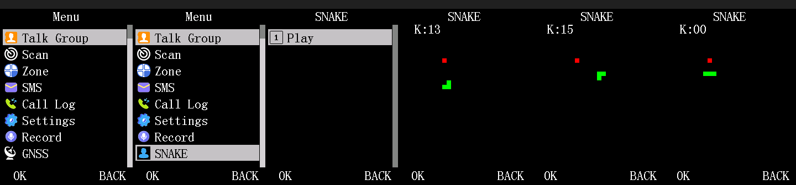

# dm32uv-re

Reverse-engineering the Baofeng DM-32UV firmware (HR_C7000 SoC, C-SKY CK803S core).

**The analysis in this repository is generated output** (`include/`, `src/`, `meta/`, `site/`,
`build/`): it is regenerated wholesale whenever the underlying analysis changes, so edits to those
directories are lost. The patch-building kit around it (`tools/`, `docs/`, `docker/`, `data/`) is
hand-maintained and survives regeneration. See [`PROVENANCE.md`](PROVENANCE.md) for the exact
firmware image behind the current contents.



*The worked example in `tools/examples/snake/`: a real 11th top-level menu category added to the
stock firmware, running under this repo's own QEMU model. More in [`docs/img/`](docs/img/).*

## Contents

| Path | What it is |
|---|---|
| `include/dm32/` | Generated C headers: primitive types, recovered structs, globals, prototypes, and unresolved references |
| `src/` | 3561 decompiled functions grouped into 28 subsystems |
| `meta/functions.json` | Machine-readable index: address, name, subsystem, confidence, call-graph degree |
| `meta/ast_families.json` | Groups of functions sharing an identical AST shape &mdash; jump-table expansions and templated code |
| `site/` | Browsable static documentation (open `site/index.html`) |
| `build/` | Makefile and target linker script for compiling the corpus (`make check` / `cross` / `report`) |
| `tools/` | **Hand-maintained.** The patch-building kit: `include/dm32_patch_api.h` (stock API), `examples/snake/` (a complete worked patch), and `src/dm32_patch_tools/` (compose an emulator image, run QEMU with a key script, render frames, gdb stub, placement scan, sector staging) |
| `docs/` | **Hand-maintained.** How the menu, keypad, RTOS and emulator workflow actually work &mdash; the narrative the function names alone don't carry |
| `docker/` | **Hand-maintained.** One image with the cross-toolchain, the QEMU board model and the decompiler |
| `data/firmware/` | **Hand-maintained.** The stock images a patch build and an emulator run need |

## Status

| | |
|---|---|
| Functions | 3561 |
| Named | 3325 (93%) |
| Unnamed (`FUN_*`) | 236 |
| CONFIRMED | 1510 |
| STRUCTURAL | 1813 |
| RAW | 238 |

### Largest subsystems

| Subsystem | Functions |
|---|---|
| `unclassified` | 889 |
| `ui-menu` | 434 |
| `codeplug` | 396 |
| `rf-frontend` | 205 |
| `ui-screen` | 196 |
| `dmr-protocol` | 180 |
| `rtos` | 172 |
| `display-driver` | 163 |
| `accessors` | 163 |
| `flash-storage` | 124 |

`unclassified` is the largest group by design. It is an honest measure of how much of this
firmware is still unknown, not a bucket to be minimized: most of its members have no recovered
name at all, and assigning them a subsystem would be invention rather than analysis.

## Confidence levels

Every function carries one, and they are not interchangeable:

- **CONFIRMED** &mdash; cross-validated against an independent source (published RTOS sources, a
  published protocol specification, or direct hardware observation).
- **STRUCTURAL** &mdash; inferred from code shape and call context. Plausible, unverified.
- **RAW** &mdash; unmodified decompiler output. The name, if any, is a guess.

Decompiled C is a reconstruction, not source. Known decompiler defects affecting this
architecture were found and corrected during this work, and at least one remains unresolved; see
[`PROVENANCE.md`](PROVENANCE.md).

## Building

```sh
cd build
make check    # host syntax-check every function
make cross    # compile every function for the real CK803S target
make report   # cross-compile, then rank the failures by error shape
```

`build/` carries a Makefile and a target linker script; `build/README.md` records the current
syntax-clean and cross-compile rates and explains what compiling this corpus does and does not
give you. In short: it type-checks the reconstruction against a real compiler for the real core,
and it does **not** produce a flashable image - there is deliberately no `make image`, and
`build/README.md` lists the four independent reasons why.

The generated headers are `-Wall`-clean. The corpus is not yet; the gap is analysis debt, mostly
globals recovered as scalars that the code dereferences as pointers.

## Writing a patch

The firmware is stock C-SKY code in flash; a patch adds new code in erased flash, then redirects
one existing instruction at it. Nothing below needs the analysis pipeline - only this repository
and Docker.

**Read first:** [`docs/menu-system.md`](docs/menu-system.md) if you are adding a screen or menu
entry, [`docs/keypad-input.md`](docs/keypad-input.md) to read keys,
[`docs/rtos-and-memory.md`](docs/rtos-and-memory.md) before you place any state, and
[`docs/qemu-workflow.md`](docs/qemu-workflow.md) for the verification loop. The complete worked
example is [`tools/examples/snake/`](tools/examples/snake/) - a real 11th top-level menu category,
verified under the emulator and on hardware.

Everything runs inside the image, which carries the cross-compiler, the emulator and the
decompiler (`cd docker && docker compose build`, once). That produces the image
`dm32uv-re-pipeline:latest`, which is the one to use; any other tag on your machine is local build
history from rebuilding the emulator, and is safe to ignore or delete. Each command below is of
the form:

```sh
docker run --rm -v "$(git rev-parse --show-toplevel)":/repo -w /repo/tools/src/dm32_patch_tools \
    dm32uv-re-pipeline -c '<command>'
```

**1. Find the code to hook.** `lookup.py` answers "what is this?" for an address or a name, and
is the fastest way in - it joins the corpus index, the sector map, the risk ratings and the
catalogued patch sites for you:

```sh
python3 lookup.py 0x03018e64              # an address: what function, what sector, what risk
python3 lookup.py --search standby        # a name or substring
```

It reports the function and its **confidence** (`CONFIRMED` is cross-validated; `RAW` is
unmodified decompiler output whose name may be a guess), its **patch risk**, the **4 KB sector**
it shares with other functions, any **catalogued patch site** in that sector, its callers and
callees, and its disassembly. Browsing `src/<subsystem>/` directly works too, and the underlying
files (`meta/functions.json`, `meta/patch_risk.json`, `meta/sectors.json`) are plain JSON if you
would rather query them yourself.

**2. Decide where your code and data live.** New code goes in erased flash; new state goes in
SRAM. A region reading as zero is *not* evidence it is free - the Snake example's state was first
placed on the RTOS scheduler's own variables, which read as zero only because they were null
pointers. Check a candidate before claiming it:

```sh
python3 placement_scan.py --lo 0x18007000 --hi 0x18007400
```

It scans flash and IRAM for literals pointing into the range and reports `clear` or `suspect`.

**3. Write the handler.** Plain C or assembly, calling the stock firmware's own routines through
[`tools/include/dm32_patch_api.h`](tools/include/dm32_patch_api.h) - display primitives, the
keypad scan, RTOS delays and semaphores, all at verified addresses with the calling convention
documented. Link `.text`/`.rodata` at your flash address and `.bss` at your SRAM address; see
`tools/examples/snake/snake_game.ld`.

**4. Build and splice.** `build_patch.py` assembles a handler, verifies the stock bytes at the
hook site before touching them, places the handler in free space and encodes the branch:

```sh
python3 build_patch.py --handler my_handler.S --stock-sector sector.bin \
    --sector-base 0x030e1000 --hook-addr 0x030e1234 --expect-hook-bytes 0011aabb \
    --hook-kind bsr --out modded_sector.bin
```

A patch that edits several sites at once (like the example) is a short Python script instead;
copy `tools/examples/snake/build_snake_patch.py`, which asserts every byte it overwrites.

**5. Verify under the emulator.** Compose a bootable image, run it with a scripted key sequence,
and look at the frames it dumps:

```sh
python3 compose_qemu_image.py --patched progmem_FULL_patched.bin --out /tmp/t.bin --iram-out
python3 qemu_run.py --image /tmp/t.bin --iram /tmp/iram.bin --sram /tmp/sram.bin \
    --rundir /tmp/run --tag t --until-step 2 --keyseq="-1:0:1:17:20:120;2:7:1:17:60:300"
python3 render_frames.py --rundir /tmp/run --last 4 --out /tmp/t.png
```

That key sequence is two steps - open the menu, then press OK - and `--until-step 2` stops once
both have been injected. `docs/keypad-input.md` has the full key table and the grammar;
`qemu_run.py` prints one `F<n>:<pixels>` token per captured frame, which is how you tell which
screen you landed on.

`compose_qemu_image.py` applies three **emulator-only** patches (anti-clone bypass, auto-power-off,
hardware-binding) that make stock firmware boot under the model. They must never reach a radio;
`stage_sectors.py` refuses to stage them.

**6. Stage for flashing.** This writes one file per changed sector plus a checksum manifest, and
refuses sectors that are sensitive, emulator-only, or inside a region whose real contents this
repository does not ship:

```sh
python3 stage_sectors.py --patched progmem_FULL_patched.bin \
    --stock ../../../data/firmware/patching/progmem_stock_DP570UV_20260926_FULL.bin \
    --out /tmp/sectors
```

**Flashing is a manual step, outside this repository, and needs a verified full backup of the
radio first.** Nothing here writes to hardware: these tools stop at producing `.bin` files, and
that boundary is deliberate.

## Scope

This repository contains analysis of a **stock vendor firmware image**. It contains no per-unit
data of any kind &mdash; no calibration constants, codeplug contents, radio identifiers, or
anything else specific to an individual device.
