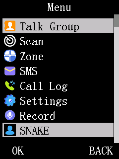

# The top-level menu system: how an item goes from index to screen

This repo's generated corpus (`src/ui-menu/`, 399 functions) already has every function below
correctly named and sized — what's missing from the generated output alone is how they connect.
This doc is that connecting narrative, written while building this repo's first example patch (a
"Snake" game added as a real, new 11th top-menu category — see `src/ui-menu/README.md` for the
full function list this doc references by name).

**Read this before adding or modifying any top-level menu item.** Every number and offset here was
confirmed by direct disassembly against the real firmware image, not inferred from the decompiled
C alone — the decompiled C for several of the functions below is subtly wrong in ways that only
showed up at the instruction level (see "Gotchas" at the end).

## The chain, start to finish

```
menu_navigation_dispatcher (0x0303f338)        <- runs when OK is pressed on the top menu
  -> menu_option_list_dispatch (0x030493f8, mode 0x17/0x18/0x23)
       -> one of ~50 menu_option_gen_idxNN functions (src/ui-menu/menu/option/)
            each APPENDS one or more raw item-index bytes (0, 1, 2, 3...) into a shared buffer,
            gated by feature/settings flags - this is the VISIBILITY layer: "is item N shown
            right now"
  -> scans the appended list for the entry whose flag byte == 0x02 (the highlighted row)
  -> transitions into that item's sub-screen

display_list_with_icons_renderer (0x03041644)  <- runs every tick while the top menu is visible
  -> for each visible row, reads p_active_screen_option_ptr_array[0][item_index] - a GB2312
     string pointer - and calls display_draw_list_row (0x03018cd8) with it
```

**The critical fact that makes adding an item tractable:** the `item_index` byte the visibility
layer appends and the `item_index` the renderer reads back are PROVEN to be the same integer, not
just structurally similar. `display_list_with_icons_renderer` reads
`p_active_screen_index_list[cursor+2]` — the exact same buffer address every
`menu_option_list_dispatch` caller passes as its own 3rd argument, the buffer the visibility
functions append into. There is no translation step between "is this item visible" and "what
string does this item draw" — they share one buffer and one integer by construction.

## The per-category string tables

Each top-menu category (there are 10 in stock firmware, selected via a 10-entry jump table at
flash `0x030aff74`, reached through the dispatch block at `0x0303d9f8` — not a function of its
own but a branch target (`bez32` at `0x0303d8e2`) inside `menu_screen_render_entry_variant`
@`0x0303d8c8`, sharing its frame and epilogue: it reads the cursor row from `0x0003e4e8+1`
(`g_menu_screen_state`), maps it through the byte table at `0x0003e63f+2`, bound-checks the
category with `cmphsi16 a2, 0xa`, and `ldr32.w`s into the jump table) owns its own flat array of GB2312 string
pointers, laid out as **all the Chinese-language entries first, then the same entries again in
English** (NOT interleaved `(zh,en)` pairs — see the Gotchas section for how that got
misdiagnosed once before landing on the right shape). A settings byte
(`p_dm32_settings_block04[0x30]`, bit 6) selects which half is active — this bit is the UI language
setting; `p_active_screen_option_ptr_array` gets pointed at whichever half is active, once, not
per-item.

Some entries in these arrays are not real strings at all — their "string pointer" decodes as
garbled bytes because it's actually a pointer into a run of sibling entries (a variable-length
GROUP marker), with a small count/type byte nearby. This repo has NOT decoded how a visible row
index selects a specific group member — only that it's a real, distinct shape from a plain leaf
entry. Not needed for a single-item category (Snake's own category is a plain leaf), but relevant
if you're adding multiple grouped sub-items under one category.

## Adding a new top-level category, end to end



*The result this section describes: `SNAKE` rendered as a real 11th category by the stock menu
code, selectable and dispatching to its own sub-list.*

1. **New string(s)**: a plain NUL-terminated GB2312/ASCII string, or an `(zh, en)` pair if you want
   a translated label, placed in free flash.
2. **New visibility append**: extend whichever `menu_option_gen_idxNN` function builds the TOP-LEVEL
   list (not a category-internal one — `idx23`/`0x17` was the one actually producing all 10
   category rows when this was traced; `idx24`/`0x18` only produces 3 of them, a shorter path used
   in a different runtime state) to append your new item's index. These functions are packed flash
   with no slack — splice via a `bsr` hook over the tail-branch to the dispatcher's shared epilogue
   (`0x0304a112`), not an in-place edit (see `tools/examples/` for the exact pattern).
3. **New category entry point**: a case-shaped stub in a RELOCATED copy of each category jump
   table, with the bound checks raised to match. The entry fills the sub-list cells and builds the
   index list, exactly as the stock cases do (see "Adding an 11th category — the proven recipe"
   below). **Do not use `ui_set_screen_mode()` here** — setting the mode byte does not run the
   screen-mode dispatcher (next section), which is why Snake v1–v5 froze on hardware.
4. **New screen**: give the category a one-item sub-list and run your screen from that item's
   slot in the item-action table, as a blocking handler (see "Blocking screen handlers" below).

## The screen-mode dispatch, and why a patch should not use it

**Not the route for a new screen.** Snake v1–v5 tried it and froze on hardware; v6+ use a
sub-list item and a blocking handler instead (`tools/examples/snake/snake_category_entry.c`
header). The facts below are kept because they explain why. (Corrected 2026-10-10; this section
previously recommended the route and gave the wrong index formula.)

- There is a **static 12-byte-stride table at flash `0x030b01a4`** with 126 rows (indices 0–125;
  row *m*'s second word is *m*+1; row 125's handler is `0x03036ca8`). It is data, not code.
- The dispatcher is the corpus function **`screen_mode_static_table_dispatch` @`0x0305279c`**
  (the corpus called it `history_entry_confirm_or_cancel` until 2026-10-10: it is the confirm leg
  of a staged back-navigation, and the "history" it pops is the screen back-stack). It computes `table + mode * 12`
  (`movi r3,0xc; mult r2,r3` at `0x030527d4`, **no** `- 1`) from the mode byte at `0x000320af`
  and calls that row's handler with **no bound check**. Mode 126 therefore lands on the first
  word past the table's end, which is packed data, not erased space: claiming a mode means
  relocating the table and repointing its one literal-pool slot (`0x0305282c`).
- **It does not run per tick.** A brute-force scan of every `bsr`/`br`/`bt`/`bf` in the stock
  image finds exactly one caller, the `bsr` at `0x030408ee`, reached only by the `bf16` at
  `0x0304073e` when the UI event code is `0x2a`. The dispatcher is also gated: it returns unless
  the arm byte `0x0003ea30` is 1 (plus a sequence-byte compare and a 2-byte `memcmp`), and clears
  that byte once it runs. Writing the mode byte generates no event `0x2a`. The Snake v1–v5
  hardware RAMDUMP showed exactly that: mode = 126, gates satisfied, arm byte still 1, dispatcher
  never ran (`snake_category_entry.c`).
- A handler in this table is `void handler(void)`. Nothing here establishes how often stock
  invokes one; do not rely on a "called once per tick" contract.

## The category jump tables hold CASE BLOCKS, not functions

**CONFIRMED by disassembly 2026-10-09**: the two category-specific action tables (shown earlier
in this doc) do NOT hold real function entry points — they hold **addresses of case blocks INSIDE
two larger dispatcher functions**. Every case block ends in the **shared epilogue at flash
`0x0303d872`** (`bsr main_menu_screen_dispatch (0x0303b6c4); addi16 sp,4; pop16 l0-l2,lr`).

The two tables are:

1. **Render-path table at `0x030aff74`** (10 entries, column-wise in the 126-row screen table):
   all case blocks INSIDE `menu_screen_render_entry_variant` @`0x0303d8c8`. Points to addresses
   of case blocks that render the sub-list for categories 0–9.

2. **Sub-list item-action table at `0x030aff18`** (10 entries): case blocks INSIDE
   `main_menu_render_and_field_edit_dispatch` @`0x0303cdf0`. Points to addresses of case blocks
   that execute item actions (up/down navigation, OK confirmation).

**The gotcha**: a plain C function pointer in such a slot is WRONG. A plain function returns with
its own `pop lr` and leaves the enclosing dispatcher's frame unpopped on every re-entry → a
**livelock** (infinite re-entry without exit; the Snake patch v10 "freeze" symptom: ~1.3 kHz
re-entry rate until watchdog reboot).

**The fix for a new slot**: point at a case-shaped **stub**, not a real function:
```asm
bsr your_handler_label
lrw r3, 0x0303d872        ; Load epilogue address
jmp r3                     ; Jump to shared epilogue
```

This replicates the case structure: call your handler (r0–r15 caller-saved, so no prologue needed),
then fall through to the shared epilogue which pops the dispatcher's frame. The target address
0x0303d872 can be reached via `lrw` + `jmp` (relative branches cannot reach that far from patch code
in the free sectors).

**For the OK-path table at `0x030afef0`** (10 entries): the stock entries are real 6-byte stubs
(`bsr handler; br16 0x0303cde6`) ending at a different shared epilogue, `0x0303cde6`. A new entry
in free flash cannot copy that shape, because `br16` (±1 KB) and `br32` (±64 KB) cannot reach the
epilogue. Snake's 11th entry is therefore `bsr handler; lrw a3, 0x0303cde6; jmp16 a3` (12 bytes,
`snake_ok_stub.S`; disassembled from the built image at `0x030e9050`).

## Adding an 11th category — the proven recipe

The `tools/examples/snake/` patch adds a real new category (Snake game) as category 10 (0-indexed),
displacing the 10-entry tables to 11-entry tables. The steps:

1. **New label string and sub-list**: write the category label (plain GB2312 string, or
   `(zh, en)` pair) and at minimum a 1-item sub-list string array in free flash at
   `0x030e8000` or later. Also define two 8-byte sub-list descriptors: `{array_ptr, count}` for
   each item type (subtype=2 for the stock generic sub-list type).

2. **Append to visibility**: the TOP-LEVEL category-list appender is **`menu_option_gen_idx23`**
   (@`0x03049cdc`; its final `br16 0x0304a112` at `0x03049dcc` is the hooked site) or `menu_option_gen_idx24`, depending on runtime
   state — use idx23 as the primary target. Hook over its tail-branch with a `bsr` trampoline that
   appends index 10 to the visibility buffer before branching to the dispatcher's shared epilogue
   @`0x0304a112`. See `tools/examples/snake/` for the exact pattern.

3. **Update bound checks**: increment all three bound-check `cmphsi16` instructions. The encoded
   immediate is the compare value minus one, so go by the raw bytes:
   - Render path (@`0x0303da02`): raw `09 3a` (`cmphsi16 a2, 0xa`) → `0a 3a` (`cmphsi16 a2, 0xb`)
   - OK dispatch (@`0x0303cd8e`): same change
   - Item dispatch (@`0x0303ced8`): same change

   (Corrected 2026-10-10: this step previously read `cmphsi16 a2, 9` → `10`, which is the raw
   field, not the instruction. `cs_disasm.py --addr 0303cd80` shows `[093a] cmphsi16 a2, 0xa`.)

4. **Relocate and extend the three jump tables**:
   - Read the original 10-entry tables from `0x030aff74` (render), `0x030afef0` (OK),
     `0x030aff18` (item)
   - Write relocated 11-entry copies to free flash (the Snake example uses `0x030e9060`, `0x030e9120`, `0x030e9160`)
   - Append your new entry (stubs as described above) as the 11th
   - Update the THREE literal-pool references (one per table) in the dispatcher code paths:
     - Render: literal slot at `0x0303da48` → your new render-table address
     - OK: literal slot at `0x0303cda8` → your new OK-table address
     - Item: literal slot at `0x0303cf18` → your new item-table address

5. **Your category entry point**: use the generic sub-list, as Snake does (a one-item "Play"
   list whose item slot runs the game). Do not call `ui_set_screen_mode()` instead: that was Snake
   v1–v5, and it froze because the screen-mode dispatcher only runs on event `0x2a` (see "The
   screen-mode dispatch" above). The generic sub-list lives at **`menu_option_list_dispatch`**
   (@`0x030493f8`) and needs initialization:
   - Count byte `0x0003e8f8` ← your item count
   - String-array pointer `0x0003e904` ← your string-array address
   - Subtype `0x18000a90` ← 2 (stock generic type)
   - Visible rows `0x0003e8f4` ← min(count, 8)
   - Call **`build_sequential_index_list`** (look up address in `meta/functions.json` by name) with
     (count, buffer_lo, buffer_hi) to fill the visibility list
   - **DO NOT call `0x03012b0c`** — that is `device_telemetry_report_build`, category 8's
     custom-text builder, which was once mistaken for a generic repaint function

## What entering an item does to UI state

When the user presses OK on an item, the stock UI **pushes one level** of history:

| address | name | change |
|---:|---|---|
| `0x000320ac` bytes 0–3 | `dialog_history_ui_state` | `02 02 03 0e` → `03 03 04 15` (four bytes advance) |
| `0x0003e8ec` | history depth counter | 2 → 3 |
| `0x0003e909` | (item depth flag?) | 0 → 1 |
| `0x0003e8f4` | visible rows | (current) → 0 |

A patch screen handler that returns through the **normal item epilogue** (the end of the case
block, which falls through to the shared epilogue at `0x0303d872`) gets **only the sub-list body
redrawn**, not the category title. This is correct for an item-details screen (showing item #N's
properties).

A **blocking-loop screen** (like Snake) that wants to redraw the full list view AFTER its own
interaction must:
1. **Restore the UI cells** by re-running your own category-entry code (recompute the sub-list)
2. **Let the stock poll dispatch a Back press** to pop the history level (see
   `docs/keypad-input.md`'s "Parking the stock poll" — arm the DEFERRED re-enable, not an immediate
   one, and leave your current/previous key bytes set so the re-armed poll will fire the Back
   handler after your handler has returned)

This restores the UI to the category view without your handler blocking the main loop.

## Blocking screen handlers: concurrent keypad polling

A patch screen handler reached from the menu tables runs in the uC/OS-III task named
**"task menu"** (TCB `0x0003e4fc`, entry `0x03040a80`, which loops `ui_event_code_dispatch_main`
@`0x0303fa04`). The stock keypad poll runs in a different task, **"task init"** (TCB `0x00040da0`,
entry `0x03068688`, which loops `main_ui_background_task_loop`). A `while(1) { ... }` blocking
loop in your handler does NOT stop the stock poll — the two tasks run concurrently.

(Measured 2026-10-10 under QEMU with gdb breakpoints during a Snake game: the game's call to
`keypad_scan_and_map_pressed_key` ran with `OSTCBCurPtr = 0x0003e4fc`, the poll with
`0x00040da0`. Names, TCBs and entries come from the `OSTaskCreate` literal pools at `0x03035f0c`
and `0x030dddd4`. This section previously said `ui_event_flag_dispatch_loop`, which is not the
task the handler runs in.)

If your handler has a blocking game loop (like Snake), **you must park the stock poll** to keep
it from interfering with your input:

1. **In your loop**: call `keypad_scan_and_map_pressed_key()` directly (don't use the stock
   dispatch handler table — your loop is the handler). After every scan, call `FUN_0301cad0()` to
   restore the LCD bus (see `docs/keypad-input.md`).
2. **Before entering the loop**: park the poll by clearing `*(u32*)0x18000800 = 0`.
3. **On exit from the loop**: arm the blanking stub to re-enable the poll ~20 polls later
   (`*(u32*)0x00030790 = 1`, counter `0x0003e395 = 0`, `0x18000800` left at 0; see
   `docs/keypad-input.md`'s "Parking the stock poll"). This deferred form is the only exit tested
   to work, and it is the form stock code itself uses. Writing `0x18000800 = 1` directly is NOT
   equivalent for a handler entered through the item-OK path: Snake v17 (re-enable after release)
   needed two extra Backs and v20 (re-enable with Back latched) lost the Back under the item
   epilogue (`tools/examples/snake/HISTORY.md` v17–v21). It is untested for other entry paths.

See `tools/examples/snake/` for a working reference implementation of a game loop that parks
the poll, reads input, updates game state, draws the frame, and repeats until Back is pressed.

## Keypad input

See `docs/keypad-input.md` for the full scan-code table. The arrows are ordinary matrix keys
(Up `0x02`, Down `0x05`); the scan's two dedicated-pin codes (7 and 4) are something else.

## Gotchas (read before you trust a quick disassembly)

1. **A jump/function-pointer table's address in the decompiled C or in Ghidra's own naming
   (`PTR_PTR_xxxxx`, `_LAB_xxxxx`) is the LITERAL-POOL SLOT holding the table's base address, not
   the table's real address.** Reading N words starting AT that named address produces
   plausible-looking garbage. Fix: disassemble the real call site (the `lrw rX, [addr]`
   immediately before the indirect call) and read the table base as the 32-bit VALUE stored at
   that literal-pool address, then re-read from there.
2. **The inverse is also a trap, and it's worse because it looks like success**: searching the raw
   image for a known table's base address as a literal 4-byte value finds not just the one real
   reference but also coincidental 4-byte matches sitting inside OTHER functions' unrelated
   literal pools. A bare hit count is not evidence of that many real call sites — disassemble each
   hit's own containing function (found via its real `push` prologue, not a guessed offset) and
   confirm it's actually inside a genuine `lrw` immediately preceding a real indirect call.
   Brute-force scanning every 32-bit `bsr` in the image and matching its COMPUTED target address
   (not a literal string match) against the function's real entry address is the reliable way to
   find real callers.
3. **CK803S `zext rd, rs, msb, lsb` is an inclusive bit RANGE, not "extract `lsb` bits."**
   `zext32 a1, a1, 6, 6` extracts a single bit (bit 6), not a 6-bit field — this was misread once
   mid-session as a 6-bit cursor and had to be corrected after cross-checking a calibration
   instruction (`zext32 l2, l2, 6, 5` against the known-correct decompiled C `flags_0x10 >> 5 & 3`)
   and an identical pattern already decompiled correctly elsewhere in the corpus.
4. **The static 126-row table's content IS a correct, independent corroboration** of the runtime
   7-byte-record table's existence (previously only a "HYPOTHESIS, unproven" in this project's own
   earlier notes) — this doc's dispatcher trace closes that out. They are two SEPARATE tables with
   two separate bound-safety stories; a fix for one does not imply anything about the other.

## Additional stock mechanisms (traced 2026-10-15)

Each item below was traced in the dm32uv-unleashed research project (not published) and is cited to its
source note there (its `docs/` directory). Static findings were read from the disassembly; where a
source marks a point as QEMU-only or unverified, that is said here too.

### Selected sub-list row: byte 0x0003e4ea

- The selected row of the open sub-list is the byte at **0x0003e4ea** (= 0x0003e4e8 + 2), 0-based. Byte +1 of the
  same struct (0x0003e4e9) is the top-level row. The category dispatcher reads +1 and the top-level index list
  at 0x0003e63f; every multi-item item-action case block reads +2 first.
- Example, category 0's case block at 0x0303cf1c: load 0x3e4e8, read byte +2, add the row to the level-2 list at
  0x0003e662, read the item, `cmphsi r2,5`, then jump through the per-item table at 0x030aff40.
- Dynamic check (QEMU run `rows`): Back returns to the sub-list with the highlighted row unchanged. Two Down
  presses inside the sub-list move the highlight without running the handler; the handler runs on OK.
- Source: `docs/sublist-cursor.md`.

### Second top-level list builder: menu_option_gen_idx24 (short VFO-mode menu)

- Two generators fill the top-level category list. `menu_option_gen_idx23` (0x03049cdc) is the full list.
  `menu_option_gen_idx24` is the short list the analog VFO shows; it never appends category id 9 (APRS).
- Which one runs is decided at the caller 0x0303f39a: helper `0x0002deb8` returning 0 or 2 selects idx24 (mode 24),
  any other value selects idx23 (mode 23).
- Observed under QEMU with the default datachip: analog VFO A shows only Scan, Settings and GNSS; digital VFO B
  (Back toggles A/B, then Menu) shows the full list ending in APRS.
- The 4-byte window at **0x03049e0a** is one of the sites the Unleashed UI patch already splices, next to the
  idx23 tail-branch hook at 0x03049dcc described above. The source note does not give the window's exact
  instruction bytes; check them before writing any hook there.
- Source: `docs/aprs-submenu.md` §1 and open question 1.

### Menu-exit timer: counter 0x0003e396, limit 0x0003e397, UI event 100

- **Counter**: `u8` at 0x0003e396, counts up about once per second from 0.
- **Limit**: `u8` at 0x0003e397 = the Menu Exit Time setting x 5 seconds (0 = Off). The apply handler
  `menu_exit_time_option_apply` @0x0304fe20 writes it and persists codeplug offset 0x32. QEMU with no codeplug
  reads 10. The boot-time source of the limit was not found statically.
- **Tick**: `menu_exit_timer_tick` @0x030544ac (formerly `keypad_text_entry_commit_gate`) runs from
  `ui_periodic_maintenance_task_loop` @0x0305476c. Its prescaler is `ui_tick_prescaler_post` @0x030546dc, which
  posts flag 0x20000 of group 0x0003fd90 after 100 background-loop counts.
- **Overflow**: the counter resets to 0 and the tick calls `write_field_and_mbox_post(1, 100)`. Event 100 means
  "leave the menu for standby". Nothing is torn down at that point; the event waits in the mailbox until the stock
  menu loop reads it, so a screen that stays up can have a pending standby event when it returns.
- **Reload**: every UI event dispatched by `ui_event_code_dispatch_main` (0x0303fa04) stores 0 to 0x0003e396.
  A patch screen that parks the stock keypad poll never produces those events, so nothing reloads the counter.
- **For a blocking patch screen**: write 0 to 0x0003e396 on entry and on every redraw tick (a 100 ms loop is
  enough; the limit is at least 5 s). Measured under QEMU: without the keep-alive, Back from a patch screen
  lands on standby; with the keep-alive it returns to the sub-list.
- Caveat: the seconds-per-count figure comes from QEMU timing and the stock setting range; hardware confirmation
  is still open in the source note.
- Source: `docs/menu-exit-timer.md` §1-§6.

### APRS category (id 9): sub-list descriptor, item table, bound check, visibility

- **Descriptor** `0x030ba924`: two `{ptr, count, subtype}` entries, one per language. Language 0 is the array at
  0x030ba8e4 and language 1 the array at 0x030ba904; both have count 8 and subtype 2. The language is bit 6 of
  settings byte 0x30. The count is 8 in both languages; rows are not hidden individually.
- **Item table** `0x030aff54`: 8 entries of case-block addresses. It is read in the case block for category 9
  (0x0303d54c, inside `main_menu_render_and_field_edit_dispatch`). The item index is the row byte at 0x0003e4ea
  read into 0x0003e664.
- **Bound check** at 0x0303d556: `cmphsi r2,8` (bytes `07 3a`). Rows at or above 8 silently go to the shared tail
  at 0x0303d872, so an out-of-range row does nothing.
- **Visibility gate**: the category row itself, not its rows, is shown by `menu_option_gen_idx23` (0x03049cdc)
  only when `[0x0003fdc0] & 4` is set and `settings_copy[3] & 0x20` is set. The settings bit is probably the
  CPS "APRS" checkbox; that is a guess in the source and was not confirmed. idx24 never shows the category.
- **Stock items under QEMU**: item 0 opens the ON/OFF picker, item 1 the "Input ID" editor, item 6 Upload Beacon,
  item 7 the "Confirm delete?" prompt.
- Source: `docs/aprs-submenu.md` §1-§2.
