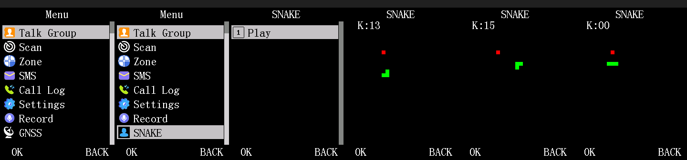

# Verifying a patch under the emulator

The `-M dm32` QEMU model is suitable for UI-layer patch verification: it boots stock firmware to the standby screen, renders the full menu system, accepts keypad input, and can detect certain classes of memory/register violations. It is **not** suitable for RF/modem work (no vocoder simulation, ALPU-MP anti-clone is patched out). Use it to verify that a UI-navigation sequence produces expected screens before flashing to hardware.



*What a verification run looks like: frames dumped by `qemu_run.py` and rendered by
`render_frames.py`. The pixel counts in the fingerprint list below correspond to these screens.
See [`img/README.md`](img/README.md) to regenerate them.*

## What the model does today

- Boots stock firmware to the standby screen and the full top-level menu with proper item counts and category dispatch (with no codeplug image it shows "Null Ch." and fewer menu rows; with `DM32_SPINOR` pointing at a SPI-NOR codeplug file it renders the real channels).
- Renders the 240×320 LCD with 256-pixel GRAM stride, RGB565 color format. Captured frames are raw 16-bit little-endian RGB565, 256-pixel stride by 320 rows (163840 bytes); the panel shows the left 240 columns.
- Accepts simulated keypad input (column driver on GPIOC, row reads on GPIOB) via the `DM32_KEYSEQ` environment variable. Each step holds a key for a configured number of GPIO reads, then releases it.
- Dumps raw GRAM on each settled frame when `DM32_GRAMDUMP` is set, optionally sequencing them with a step counter when `DM32_GRAMSEQ=1`.
- Provides a `gdb` stub on port 1234 (invoked with `-s`) for register reads, memory inspection, and watchpoint debugging.
- Models the LCD/keypad pin-mux trap: writes to the LCD data bus while `IO_DIPLEX2[15:9]` has the keypad pins muxed to GPIO force the panel to white with a one-time diagnostic message. This catches the hardware-only failure mode (stock firmware hangs on the first keypad scan if `lcd_bus_restore_after_keypad_scan()` is not called afterwards).
- (2026-10-14, merged `gap/integration` batch) Models the DesignWare GPIO port-A interrupt block on all three banks, and injects logical pins at virtual times (`DM32_PINSEQ`, `DM32_KNOB`, `DM32_KNOB_EDGE_MS`, `DM32_PTT`; see "Injecting the knob, PTT and other pins" below).
- (2026-10-14) Program flash (`0x03000000`, 1 MB) is a read-only ROM device: stores are dropped and counted, and `DM32_FLASH_WRITABLE=1` restores the old writable RAM. Stock also sends SPI-NOR opcodes through this window (an open item: the LCSFC programming path is not documented in the public datasheet).
- (2026-10-14) SPI-NOR program and erase persist for the run; `DM32_SPINOR_OUT=<path>` writes the changed store(s) at exit, `DM32_SPINOR_SYNC=1` after every write, and `DM32_SPINOR_WIP_READS=<n>` sets how many RDSR polls report busy (default 2).
- (2026-10-14) A counting watchdog at `0x14010000` resets the guest on expiry (`DM32_WDT_LOG=1`, `DM32_WDT_NORESET=1` for log-only bites). Its timeout is an assumption: the clock and reading are unverified.
- (2026-10-14) Wires the CPU-side DAC (`DM32_DAC_LOG`, `DM32_DAC_TRACE`), the DMR baseband RAM at `0x16000000` as capture-only RAM (`DM32_DMR_LOG`, `DM32_DMR_TRACE`, `DM32_DMR_DUMP`), and the FD6818 RF bus on GPIOA (`DM32_FD6818_*`). Accesses to unimplemented windows (PWM at `0x140c0000` and others) are logged under `-d unimp`.

Three QEMU-only patches, applied by `compose_qemu_image.py` and guarded by byte-exact assertions on the stock image:
- **ALPU-MP anti-clone bypass** at sector offset 0xC6000: the coprocessor challenge-response is NOPped so real stock code runs without the anti-clone check.
- **Auto power-off bypass** at 0x1BDE0: the battery-voltage ADC read that would otherwise fail under the model is NOPped; the firmware completes its initialization.
- **Hardware-binding record** at 0xB10C: no code is changed. The shipped images have the per-unit sector (`0x0300b000`) blanked, so the eFuse-derived binding record at `+0x10c` reads `ff ff ff ff` and never matches; `compose_qemu_image.py` writes the data value `ff 18 ff ff` there, which the model accepts (`scrub_unit_sector.py` docstring; why that value satisfies the check under the model is not documented).

**These three sectors must NEVER be flashed to a real radio.** `stage_sectors.py` refuses to stage them unless `--allow-qemu-only` is explicitly passed.

## The workflow loop

The verification loop is: build → compose → run → render → stage.

> **Paths and the container.** The `/tmp/...` paths below are inside whatever shell you run
> these in. If you use the one-shot `docker run ... -c '...'` form from the top-level README, the
> container's `/tmp` is discarded when the command exits, so results vanish. Either run the whole
> sequence in one `-c '...'` (as the examples do), or write outputs under the mounted repo
> (`/repo/...`) so they land on the host.

```sh
# 1. Build the patch (assembles handlers, splices into sectors, cross-checks addresses)
make build-patch HANDLER=myhandler.S STOCK_SECTOR=sector_030e1000.bin \
    SECTOR_BASE=0x030e1000 HOOK_ADDR=0x030e100c HOOK_BYTES=08ea0000 \
    OUT=sector_030e1000_patched.bin

# 2. Compose a bootable QEMU image (base + patched sectors + QEMU-only patches)
python3 compose_qemu_image.py \
    --patched progmem_FULL_patched.bin \
    --out /tmp/boot.bin --iram-out

# 3. Run under QEMU with a keypad sequence, collect raw GRAM dumps
python3 qemu_run.py \
    --image /tmp/boot.bin \
    --tag mytest \
    --until-step 12 \
    --keyseq="-1:0:1:17:20:120;2:7:1:17:60:300;..."

# 4. Render the GRAM dumps as viewable images
python3 render_frames.py --rundir qemu-run/mytest --last 4 --out /tmp/result.png

# 5. Stage the real (non-QEMU-only) sectors for flashing
python3 stage_sectors.py \
    --patched progmem_FULL_patched.bin \
    --stock ../../../data/firmware/patching/progmem_stock_DP570UV_20260926_FULL.bin \
    --out /tmp/mytest_sectors
```

For detailed examples see `tools/examples/snake/README.md`: the complete Snake game patch runs through all five steps.

## Reading the results

Frame "non-black pixel" counts serve as fingerprints of expected states:
- Standby screen (no codeplug): ~2990–4433 pixels (depending on the Null/battery display variant).
- Main menu: ~13300–14300 pixels (with or without a codeplug; r69/r75).
- Snake sub-list: 9472 pixels.
- Snake game frame: ~1175 pixels.
- Snake game frames while a key is shown in the overlay: 1138–1170 pixels (the readout changes the count).

When `qemu_run.py` stalls at a particular step (PC stuck, no frame settle detected for longer than the timeout), the rundir contains:
- `qemu.log` — QEMU's own stderr/stdout: `KEYSEQ -> step N` lines (how far the script got) and `GRAMDUMP[i] settled: nonblack=N` lines (every captured frame).
- `gram.raw.NNN` — raw GRAM capture at that point (or the last settled frame if it hung before reaching another settle point).

A stall at an early step (keyseq step 0–2) often indicates the boot itself did not reach the menu — check that the ALPU-bypass and auto-poweroff patches were applied (verify `compose_qemu_image.py` was run without `--no-qemu-only-patches`). A stall at a later step usually means the screen handler or a called primitive did not return cleanly.

**Token line fields (2026-10-14).** `qemu_run.py` ends its summary line with `unimp=N invalid=M`. `unimp` counts
`unimplemented device read|write` lines in the QEMU log, which are accesses to windows the model logs but does not
implement (the PWM block at `0x140c0000` is the one still hit by stock). `invalid` counts `Invalid read|write at addr`
lines, which are accesses to unmapped addresses. Both need the default `-d unimp,guest_errors,invalid_mem` logging;
`--no-qemu-log` turns it off, and both fields then print `-`. The regression compares the step count, the crash and
muxwarn counts and the key pixel-count fingerprints, not the whole token line, because the frame order changes with
host load (the unmodified base does the same).

### Injecting the knob, PTT and other pins

Pins that are not keypad matrix steps are driven by three virtual-time injectors in the board model:
`DM32_PINSEQ="t:pin:level;..."` forces a logical pin to `0` or `1` at `t` (`-` releases it), `DM32_KNOB="t:+N"` or
`"t:-N"` emits `N` quadrature detents on pins 0x26 and 0x27 (spacing from `DM32_KNOB_EDGE_MS`, default 5 ms), and
`DM32_PTT="t:hold_ms"` forces pin 0x2b low for `hold_ms`. Times are virtual milliseconds from start, and each event
logs under `DM32_KEYLOG=1`. The pin identities (knob 0x26/0x27, PTT 0x2b) are hypotheses from the project
pin map, and PTT active-low polarity is an assumption; both need hardware confirmation. The power-switch sense is
GPIOA 16 (pin 0x10), which the model holds low by default (`DM32_GPIO_IDLE_LOW`); GPIOA 17 (0x11), which the model's
key-injection page still lists as power, is the power-hold output (`specs/dts/README.md`). Examples and caveats:
`vendor/dm32uv-qemu/docs/key-injection.md`.

## Debugging under QEMU

For register and memory inspection without stopping the emulator:

```sh
python3 gdb_rsp.py regs                    # pc, sp, lr, psr, r0-r7
python3 gdb_rsp.py mem 0x18007000 0x100   # hex dump 256 bytes
python3 gdb_rsp.py watch 0x18007ff0 4 --until-nonzero  # poll until word changes
python3 gdb_rsp.py crashwait --dump 0x18007000,0x100   # wait for halt, dump memory
```

**Important caveat:** watchpoints defeat TCG translation-block chaining, which can mask timing-dependent bugs. A crash under `watch` that does not reproduce in a normal run, or vice versa, is a strong hint that the bug depends on TB chaining. Always re-run without the watchpoint to confirm.

For execution profiling, capture a trace and analyze it:

```sh
qemu-system-cskyv2 -M dm32 -cpu ck803 \
    -d exec,nochain -D /tmp/trace.log \
    -kernel /tmp/boot.bin \
    -device loader,file=/tmp/iram.bin,addr=0x00010000 \
    ...

python3 pc_histogram.py --trace /tmp/trace.log --out /tmp/windows --window 10
python3 pc_histogram.py --map /tmp/windows/pcw_00.txt --top 20
```

**Caveat:** `-d nochain` also defeats TB chaining; use it only to find where execution is stuck, not to benchmark normal operation. The `-d exec` FIFO recipe (for live sampling without the log file) is documented in `pc_histogram.py`'s module docstring.

## Known pitfalls and their signatures

**Stale PC after PSR write:** the CPU model's register save happens before (not after) a PSR-affecting instruction, so early in boot the PC register reads as 0x0300xxxx when it should be ahead by 4 bytes. This was fixed in `vendor/csky-qemu/target/csky/translate_v2.c` with `gen_save_pc(ctx->pc + 4)` before `gen_helper_mtcr_cr0` and `gen_helper_psrset`. If you see `pc=0x0300xxxx`, `sp=0xfffffffc`, and `OSPrioHighRdy=0x41` (IRAM initial state) in `gdb_rsp.py regs` output very early in a run, the fix is missing — verify that `vendor/csky-qemu` is checked out and the build includes it.

**AES (or anything using the SRAM-init tables) returns garbage under a `compose_qemu_image.py --iram-out` bundle:** that script's `sram.bin` is 32 KiB of zeros, but the AES S-box and Rcon live in the SRAM initialised-data image (S-box at SRAM `0x1800119c`, copied from flash `0x03072000` by the boot stub). With zeros there, `aes_block_encrypt` runs without error and returns key bytes where ciphertext should be. Build the SRAM image yourself: the `0x43fc`-byte init image at flash file offset `0x72000`, placed at offset `0x800` of a zeroed 32 KiB buffer and loaded at `0x18000000` (`tools/src/dm32_patch_tools/crypto_kat.py` and `rng_seed_probe.py` do exactly this). Found 2026-10-13.

**Perfect render under QEMU, failure on hardware:** the pin-mux model (IO_DIPLEX2) is correct, but check that every keypad scan is followed by `lcd_bus_restore_after_keypad_scan()` before the next LCD write. This is a hardware-only failure: the screen hangs if the bus is not returned to the LCD. The QEMU model now forces LCD data to white when the mux is wrong, so a forgotten restore should show up under emulation too — but if it does not, double-check the driver's GPIO pin routing against the stock firmware (use `tools/src/dm32_patch_tools/cs_disasm.py` or the Ghidra corpus).

**Model answers unconditionally:** a QEMU model that tolerates out-of-range memory accesses or executes intentionally-broken instructions can hide real driver bugs. A run that produces a perfect screen under emulation can still fail on hardware if the model was too forgiving. Validate critical paths (especially around hardware control like GPIO and SPI) by inspecting the assembly or running them under hardware.

**A function returns with the wrong calling convention:** C-SKY ABIv2 return address is in `lr` (r15); a function that returns via `jmp <wrong_register>` leaves `lr` unchanged and the caller's stack frame unpopped. This appears as a stall in the next function after a spurious stack offset is applied. The Snake example hit this when its case-block slots held plain C functions. The fix is an asm stub that restores nothing itself: `bsr handler; lrw a3, 0x0303d872; jmp16 a3` tail-jumps into the stock case tail, and that tail (`bsr main_menu_screen_dispatch; addi16 sp,4; pop16 l0-l2,lr`) pops the enclosing frame — see `tools/examples/snake/snake_tail_stub.S` and `HISTORY.md` (v10–v11).

**Stock soft-float is mis-emulated by `-M dm32`:** the stock int-to-double conversion returns 256.0 for 360 under this
model, so any float result from a stub or from stock soft-float code is not evidence under QEMU. Check float arithmetic on
hardware, or by hand against the source's own constants, not against a QEMU run. The 2026-10-15 dm32uv-unleashed work
reports the same problem for its distance/bearing stub, which it verified by intercepting the soft-float calls rather
than by running the arithmetic under QEMU (its `feature-checklist.md` at the repo root, item F7). The 256.0 figure is a reported observation
from that work, not re-measured here.

## Viewing the emulator live

Open a VNC viewer on port 5900 while `qemu_run.py` is running (it prints the VNC URL when `--vnc 0` is passed):

```sh
python3 qemu_run.py --image /tmp/boot.bin --vnc 0 ...
# In another terminal:
open vnc://localhost:5900  # or: vncviewer localhost:5900
```

The `-M dm32` board model does not render a live screen in the QEMU display window; VNC shows the GRAM contents at the rate they settle (typically a few frames per second during menu navigation, faster during idle polling).

## A generic codeplug for the emulator

**What it is.** The emulated 16 MB W25Q128 data chip starts blank, and stock then boots to "Null Ch."
with no channels, zones or talk groups, so anything needing a channel (channel change, encrypted-channel
code paths, the "with a codeplug" menu layout) cannot be tested. `datachip_generic_factory_defaults.bin`
(`data/firmware/patching/`, xz'd, sha256 `487b33f8940813d265db5b2db15dc5fe99c5cabaa5dadbb4de9b4c3f2788f2f2`)
is the codeplug the stock firmware writes itself: `codeplug_factory_defaults_write` @0x03032434 (void, no
args; 2512 bytes) erases the 48 channel-bank pages (block ids 0x12..0x41), writes 16 default channels
"Channel 1".."Channel 16", then rewrites blocks 0x42, 0x43, 0x0b, 0x44..0x48 (talk groups), 0x0f, 0x5c
(zones), 0x5d..0x64, 0x11 and others.

**Why it is allowed here.** Every byte comes from constants inside the generic stock firmware image,
executed by the emulator. It is identical on every unit and contains no per-unit data (no calibration
content, DMR ID, serial). Nothing is read from a radio.

**How to make it** (inside a QEMU container built from the `gap/ssi-persist` branch or later, which adds
`DM32_SPINOR_OUT`; ~45 s, deterministic):

    python3 tools/src/dm32_patch_tools/make_generic_datachip.py --out datachip_generic.bin

It refuses to run if `DM32_SPINOR` is set. Route A (implemented): boot stock with `-s` and
`DM32_SPINOR_OUT`, interrupt over RSP after 40 s (standby), save all registers (`g`), set sp = SRAM scratch
`0x18007b00`, lr = sentinel `0x169d4` (hardware breakpoint), pc = `0x03032434`, continue; on the breakpoint
restore the registers with `G`, continue, SIGTERM QEMU so the store is dumped. It worked first try:
the call returns (the RTOS keeps scheduling during it) and the register restore reports `OK`. Route B
(not needed, not traced): drive the UI "reset to factory" confirmation with `DM32_KEYSEQ`
(callers FUN_03014a54 / FUN_030156f4, gated on bit 2 of a UI state byte).

**How to use it.** `qemu_run.py --image <boot.bin> --iram <iram.bin> --sram <real sram.bin> --spinor datachip_generic.bin ...`
(`xz -d` the committed file first). The image is read-only input unless you also set `DM32_SPINOR_OUT`.

**What changes on screen** (stock, standby then MENU then Up; frame tokens vary with settle timing,
so compare nonblack pixel counts, not the whole token line):

- Blank chip: "Null Ch." twice, full menu (Talk Group, Scan, Zone, SMS, Call Log, Settings, Record, GNSS,
  APRS), standby 13618, menu 13796 (the existing stock fingerprints).
- With the image the radio starts in **VFO mode** (A 144.125 ANA, B 430.125 DIG), standby 12537, menu
  rows Scan/Settings/GNSS (token line `F0:0 F1:76800 S1 F2:12537 F3:11935 F4:10830 S2 F5:10820 S3 F6:12537`).
- A long press of Back (`2:10:1:17:3000:600`) switches the A side to **channel mode**: "Zone-Ana", "CH 1",
  431.125 MHz, standby 12763; menu Scan/Zone/Settings/GNSS; Menu > Zone > "Zone List 1/3" shows
  Zone-Ana, Zone-Dig, Add Zone; Zone-Ana > Channel List shows "Channel 10".."Channel 16" (7 entries;
  Zone-Dig presumably holds 1..9, not checked). The standby line shows zone name and "CH 1", not the
  channel name "Channel N"; the name appears in the channel list.
  Key sequence for the Channel List: `-1:0:1:31:0:20;2:10:1:17:3000:600;-1:0:1:17:20:120;2:11:1:18:60:300;2:7:1:17:60:400;2:7:1:17:60:400;2:11:1:18:60:300;2:7:1:17:60:400`
  (tokens `... S8 F14:12763`, menu frames 11530/11385/10669/11295/10773).

**What it does NOT contain.** 89 4 KB pages are touched (inventory printed by the tool): channel banks
0x12 and 0x41, blocks 0x42/0x43/0x0b/0x0f/0x10/0x11/0x0a, zone page 1 (0x5c), talk-group pages
0x44..0x48 and 0x65..0x67 hold data; the other channel-bank/zone pages are erased with only their tag
byte (+0xFFF) written. Block 2 (the per-unit calibration slot, tag 0x02) is a tag-only page written by the
stock *boot* itself, not by the routine; it has no calibration signature and was never fabricated. Stock
shows no calibration complaint with it. Not present: contacts (DMR contact database, V-frame 0x09 region
at 0x6dc000.. holds only three tag bytes from the first boot), the font/V-frame 0x06/0x07 regions, real
calibration. Zones exist, so the firmware does not show "no zone"; the "Null Ch." state is gone.
