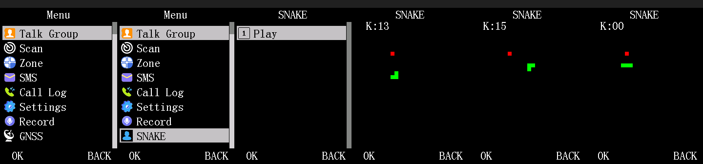

# Worked example: Snake, a real 11th top-level menu category

The complete patch this repo's docs were written against: a new top-menu category ("SNAKE") with a
one-item sub-list ("Play") whose item runs a blocking game loop, then hands control back to the
stock UI cleanly. It exercises every mechanism a non-trivial patch needs, and every one of them was
first got wrong and then fixed on the real radio and under this repo's QEMU model -- `HISTORY.md`
is the full root-cause log (v1-v22), kept because the failure modes are the real documentation.



*Left to right, all captured under this repo's QEMU model: the stock top menu, the same menu
scrolled down to the new **SNAKE** category, its one-item sub-list, and three frames of the game.
See `docs/img/README.md` for how to regenerate them.*

| file | role |
|---|---|
| `snake_game.c` | the screen handler: blocking loop, keypad scan under the bus semaphore, LCD restore after each scan, parking/re-arming the stock poll, deferred Back hand-off (see `docs/keypad-input.md`) |
| `snake_category_entry.c` | fills the sub-list cells the stock renderer reads (`docs/menu-system.md`) |
| `snake_tail_stub.S` | case-shaped stubs for the render/item jump tables (`bsr handler; lrw r3, tail; jmp r3`) |
| `snake_ok_stub.S` | OK-path table stub, same contract as the stock 6-byte `bsr; br16` stubs but 12 bytes (`bsr handler; lrw r3, 0x0303cde6; jmp r3`), because `br16` cannot reach the epilogue from free flash |
| `snake_menu_append_trampoline.S` | `bsr` hook that appends category index 10 to the visibility list |
| `snake_game.ld` | `.text/.rodata` at 0x030e8000 (entry function forced first), `.bss` at SRAM 0x18007000 |
| `build_snake_patch.py` | builds every blob, splices the six touched sectors into the stock image with byte-exact expectations, writes `progmem_SNAKE_patched.bin` + per-sector `sector_*_patched.bin` |

## What is committed

Tracked: the hand-written sources above, `snake.patch.json`, the six `sector_*_stock.bin`, the six
`sector_*_patched.bin` and the golden `progmem_SNAKE_patched.bin` (1 MB). Not tracked (regenerated,
git-ignored): the per-blob `snake_*.bin/.elf/.o` intermediates. A build must reproduce the tracked
golden image byte for byte; `tests/` checks that.

## Prerequisites

- Docker, and the repo's toolchain/QEMU image (`docker/README.md`; `docker compose build`). The
  commands below use the placeholder `IMAGE` for whatever you tagged it (e.g. `dm32uv-re-pipeline`).
- The stock image `data/firmware/patching/progmem_stock_DP570UV_20260926_FULL.bin` (in the repo).
  It is a scrubbed base: its per-unit sector `0x0300b000` is blank, and nothing here ever writes it.

Every command below is run from the repo root through this wrapper:

```sh
docker run --rm -v "$(git rev-parse --show-toplevel)":/repo -w /repo IMAGE -c '<command>'
```

## 1. Build (manifest path, recommended)

```sh
python3 tools/src/dm32_patch_tools/build_manifest_patch.py tools/examples/snake/snake.patch.json \
    --out /tmp/snake_out --compare tools/examples/snake/progmem_SNAKE_patched.bin
```

Compiles the six blobs, splices the six touched sectors into the stock image with byte-exact
expectations on every byte it overwrites, and `--compare` must end with `byte-identical to ...`
(image sha256 `9285d57a...4461`). Outputs land in `/tmp/snake_out/` (image, per-sector files,
`summary.json`). `make -C tools snake-manifest` does the same inside the image's working dir.

`build_snake_patch.py` is the original hand-written build script the manifest was derived from; it
still works and gives the identical image, but it writes its outputs next to itself (so it
rewrites the tracked patched files with the same bytes):

```sh
cd tools/examples/snake && CSKYBUILD=/repo/docker/cskybuild.sh python3 build_snake_patch.py
```

## 2. Verify under QEMU

The stock firmware needs three QEMU-only patches to boot under `-M dm32`;
`compose_qemu_image.py` adds them to a copy (they are never part of the staged set). This key script
runs without a codeplug image: Menu, Up (wraps to SNAKE), OK (sub-list), OK (Play), four direction
changes (`2`/`4`/`6`/`8` keys), Back, Back.

```sh
cd tools/src/dm32_patch_tools
python3 compose_qemu_image.py --patched ../../examples/snake/progmem_SNAKE_patched.bin \
    --out /tmp/snk/boot.bin --iram-out          # also writes /tmp/iram.bin and /tmp/sram.bin
python3 qemu_run.py --image /tmp/snk/boot.bin --iram /tmp/iram.bin --sram /tmp/sram.bin \
    --rundir /tmp/snk/run --until-step 11 --settle-after 25 --timeout 500 \
    --keyseq="-1:0:1:31:0:20;-1:0:1:17:20:120;2:11:1:17:60:400;2:7:1:17:60:400;2:7:1:17:60:600;2:11:1:18:150:500;2:8:1:20:150:500;2:11:1:17:150:500;2:8:1:18:150:500;2:10:1:17:150:900;2:10:1:17:150:900"
python3 render_frames.py --rundir /tmp/snk/run --last 8 --out /tmp/snk/snake.png
```

(`mkdir -p /tmp/snk` first.) Expected token line: non-black pixel counts of successive screens
`0, 580, (an optional 2993 boot frame), 13618, 13309, 9472, 1175, 1166, 1175, 1138, 1175, 1164, 1175, 1142, 1175, 2993, 2997` --
boot, standby, menu, SNAKE row, sub-list, then game frames (1175 between direction changes) and the
stock UI after Back. `tests/test_image_snake.py` asserts exactly this sequence. With a programmed
codeplug (`--spinor`, not shipped: it is per-unit data) the menu has more rows and SNAKE is reached
with Down x10 instead of Up, and Back returns to the sub-list rather than standby.

## 3. Stage for the radio

```sh
python3 stage_sectors.py --patched ../../examples/snake/progmem_SNAKE_patched.bin \
    --stock ../../../data/firmware/patching/progmem_stock_DP570UV_20260926_FULL.bin \
    --out /tmp/snake_sectors
```

This verifies each changed sector against the stock image and writes six `sector_*_patched.bin`
files, `MANIFEST.sha256` and the flash command template for each.

**Flashing is a manual, human-run step** (nothing in this repo writes flash). Do it only with a verified full backup of your own
unit (program flash and data chip: the data chip holds per-unit calibration that cannot be restored
from another radio's image), and write only the staged sectors. The three QEMU-only patches are never part of the staged set.

See `HISTORY.md` for the full v1-v22 root-cause log of how this design was arrived at.

## Known limitation of the visibility hook

`menu_option_gen_idx23` (0x03049cdc) reaches the shared epilogue 0x0304a112 through four exits:
three early `bez` branches (0x03049d8a, 0x03049db0, 0x03049dbc) and the final `br16` at
0x03049dcc. The trampoline replaces only the final `br16`, so SNAKE is appended only on that path.
It is the path taken on a configured radio and on a blank codeplug under QEMU (the trampoline
executes once per menu build in the exec trace), but a radio in whatever state takes one of the
early exits will not show the category. A `bsr` hook over each of the three `bez` sites is the
fix if that ever matters.
